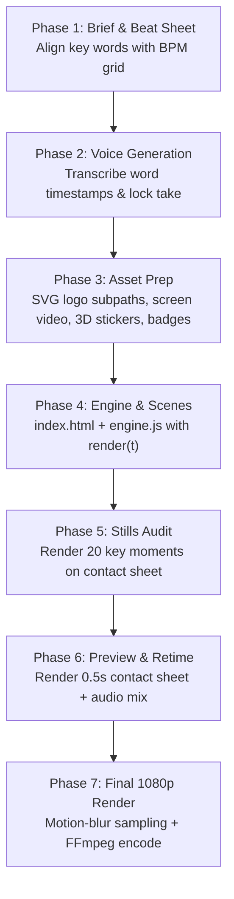

# App Ad, Built Entirely in Code (Continuous Light Method)

A complete production method for a 15–30 second high-conversion mobile app commercial, rendered frame by frame entirely in code from a real screen recording. Zero hard cuts, no AI video, and no stock footage: every scene change is a circular wipe that follows a single continuous light comet that never stops moving.

*Reference build: keemfinity's Mano app ad "Products you love." (19.3 s, 16:9, 1920×1080, 30 fps, 579 frames).*

---

## The 6 Principles That Make the Difference

1. **The logo's own shape is the hook:** Split the logo mark into subpaths. The light traces the real frame outline like a pen in the first 0.4s, then the solid logo slams in on a spring. It reads in half a second, putting the brand first.
2. **One light does every job:** It never stops moving. It acts as pen, underline, 3D orbit, wipe edge, button outline, clock ring, delivery route, and final icon landing. Because it never stops, the entire film feels like one continuous shot.
3. **The real product, not a mockup:** Use real app screen recordings, real categories, and real prices. Crop status and navigation bars, replace private names/addresses with clean local data, and skip incoming notification frames.
4. **Direct every line of the voice:** Use inline audio emotion/pacing tags (`[curious]`, `[excited]`, `[warmly]`, `[confident]`, `[pause]`). Test 2–3 voices, lock one take, transcribe word timestamps, and move the visuals to the words—never time-stretch the voice.
5. **Retime instead of rebuilding:** If voice pacing changes, use a **monotone cubic time-warp table** (`film_time -> design_clock`, one anchor per key word) to re-time the entire film and sound cues in one edit.
6. **Give the light a destination:** A light that just hovers or stops at the end feels unfinished. Spiralling into the app icon with an icon bump and a bell chime decisively closes the film.

---

## Technical Stack & Hardware Budget

- **Scene File:** `index.html` (all DOM elements) + `engine.js` exposing `render(t)` that sets transforms, opacities, and redraws the light canvas at time `t`.
- **Headless Renderer:** Node.js + Playwright (headless Chromium) calling `render(t)` and capturing snapshots.
- **Motion Blur & Frame Pipe:** Python 3 (`numpy`, `Pillow`, `OpenCV`) taking 3 sub-frame screenshots across half a frame, averaging them in numpy, and piping raw `rgb24` frames to FFmpeg.
- **Assembly & Audio:** `ffmpeg` with `libx264` and `loudnorm`.
- **Typeface:** Poppins (Google Fonts, OFL), weights 500 / 600 / 700 / 800, tight tracking (`-0.02 em`).
- **Render Speed:** ~0.35 s per 1080p frame (3 motion-blur samples) on 2 CPU cores. The entire 19.3s film renders in ~3.5 minutes. Stills render in < 1 second.

---

## The Continuous Light Architecture

Every light in the film is **one comet** drawn on a 2D canvas over the entire stage.

### Path & Spline Generation
- The path is a continuous list of keypoints `(t, x, y)` across the whole film, joined with a **Catmull-Rom spline** so the head never abruptly halts and hand-overs remain seamless.
- Standard path helper primitives:
  ```javascript
  P(t, x, y)                              // Discrete keypoint
  ellipse(t0, t1, cx, cy, rx, ry, a0, a1) // Orbits, clock ring
  pillPath(t0, t1, cx, cy, w, h)          // Pill and button stadium perimeters
  poly(t0, t1, points, ease)              // Underlines, road delivery routes
  headAt(t)                               // Catmull-Rom position evaluation
  ```
- Logo outline points are sampled densely using `getPointAtLength()` directly on the brand mark's SVG path.

### Comet Anatomy
- **Head:** 11 px dot with a 5.5 px solid white core.
- **Tail:** Spans the last 0.26 s of the path, sampled 34 times.
- **Tail Width & Taper:** Width tapers with `alpha^0.7` toward the tail end.
- **Two-Pass Rendering:**
  1. *Glow pass:* 26 px width, `shadowBlur: 34`, 55% alpha.
  2. *Core pass:* 13 px width, high opacity.
- **Color Inversion at Stages:**
  - White comet on Brand Red stages.
  - Brand Red comet on Warm White stages.
  - A 0.08 s cross-fade at every wipe boundary.

---

## Visual Design & UI Kit (Sizes at 1080p)

### Palette & Stage Concept
Two alternating stages that flip on every circular wipe:
- **Brand Stage (e.g. Red):** Radial gradient `#F6414F -> #EE2737 -> #D2182A`.
- **Warm White Stage:** Radial gradient `#FFFFFF -> #FFF8F8 -> #FDEBEE`.
- **Neutrals:** Ink `#17171A`, Secondary text `#6B6B70`, Map blocks `#EFF1F4 / #E6E8EC`, Phone body `#3A3A3F -> #121214`.
- **Red Glow:** 28% opacity.

### Rebuilt UI Components
| Component | Dimensions & Spec | Motion Behavior |
|---|---|---|
| **3D Phone** | 520×1060 px, radius 84 px, dark gradient body with 3 px hairline. Screen 488×1028 px, radius 68 px, black dynamic island. CSS 3D `perspective(2600px)` + blurred soft shadow. | Flies in on spring (`rotateX: 58° -> 8°`), shows splash screen then cuts to real app scroll sequence. |
| **Category Pills** | Height 150 px, radius 75 px, brand red, Poppins 700 72 px, 104 px sticker icon on left. | Light traces pill outline (0.24 s), pill springs in; previous pills cascade below at 62% and 46% scale/opacity. |
| **Price Chips** | White, radius 40 px, 26 px grey label over 54 px red price ("NGN 749", "NGN 2,999"). | Pop in sequentially as light hops between them. |
| **Action Button** | 680×176 px, radius 88 px, red. "Add to cart" with cart icon. | Traced by light; on "cart" presses (-7%), ripple effect, flips to "Added to cart" with check, black badge "1" pops. |
| **Clock "o"** | Inline 0.66 em clock inside headline (e.g. inside "seconds"). | Drawn by light into a red ring, internal hand spins. |
| **Drifting Map** | 13×13 grid of rounded blocks (140 px, radius 30 px), rotated -10°, drifting slowly. | 18 px red polyline route with round joins; red pin drops with pulse ring; "Order Delivered." card pops. |
| **3D Stickers** | Glossy 3D product/grocery stickers (8 items + delivery vehicle), isolated with flood-fill mask. | Spiral out into orbit around text, matching light travel. |
| **End Card** | App icon 280 px (radius 66 px), Brand name, Category rating (five stars + 4.7), "Download now" 112 px, App Store & Google Play badges (410 px wide), City labels. | Badges spring in; light orbits badges, lifts off, spirals 1.15 turns into app icon, triggers landing chime & shine sweep. |

---

## Render Order (Per Frame)

Every frame in `render(t)` compiles in this exact layer stack:
1. Stage background gradient (Brand or White).
2. Circular wipe layer (`clip-path: circle(...)` expanding from the light's current coordinate).
3. Map grid & route polyline.
4. Geometric decorative arcs.
5. Kinetic typography headlines (words sliding up out of overflow masks).
6. 3D glossy stickers.
7. 3D Phone container & drop shadow.
8. Pills, chips, buttons.
9. Scooter, drop pin, delivery card.
10. Logo mark, shockwave ring, shards.
11. Impact flash.
12. 2D Light comet canvas (always on top).
13. Global camera transform: slow drift (`±0.8%`), screen shake on hits, zoom on transitions.

---

## Master Beat Sheet & Timing Blueprint (134 BPM)

- **Music Grid:** 134 BPM, 1 bar = 1.791 s.
- **Track drop:** Lands on first word at **1.30 s**.
- **Logo Hit:** Downbeat 7 bars later at **13.84 s**.

```
TIME (s)       ACTION & VISUAL CHOREOGRAPHY
0.00 – 0.55    HOOK (Red Stage). Frame 0 already moving. Light traces logo outer frame, 
               three stripes draw behind it (staggered 0.07 s).
0.55           SLAM. Solid white logo mark fills in on spring (overshoot 1.08 -> 1). 
               Soft flash, expanding shockwave ring, 16 shards, 26 px camera shake.
0.65 – 0.90    Light sweeps under logo, revealing brand wordmark left-to-right at its head.
1.10 – 1.31    White circular wipe opens from logo; logo shrinks into wipe center.
1.28 – 2.60    "Out of groceries?": "out of" slides from mask; "groceries?" pops letter-by-letter 
               (35 ms interval), "?" wobbles. 8 stickers spiral into orbit with the light.
2.64 – 2.95    Light sweeps diagonally; red circular wipe follows from bottom-left corner.
2.85 – 4.00    "Open Mano": Phone flies up on spring (rotateX 58° -> 8°), splash screen cuts to 
               real home screen on "Mano" (3.22 s). Big wordmark pops, arcs rotate, light orbits phone.
4.00 – 4.25    Phone swings right; white wipe opens at pill origin.
4.24 – 5.90    "Groceries, food, pharmacy": On each word, light traces pill outline (0.24 s), 
               pill springs in, previous pills drop below smaller and lighter.
6.46 – 7.50    "all in one app": Phone rises on right showing home screen, pills fly into it, 
               headline slides up, light underlines it.
7.55 – 7.74    Red wipe opens from the phone.
7.92 – 9.90    "Local market": Phone scrolls real grid (79 frames); light underlines text. 
               "Cheaper prices" swaps at 8.94 s; 3 price chips pop, light hops between chips.
9.97 – 10.31   White wipe. Light draws button perimeter; red button fills on "Add" (10.26 s).
10.56          On "cart", button depresses (-7%), ripple plays, label flips to "Added to cart", badge "1" pops.
11.09 – 11.45  "in seconds": Light draws clock ring inside "seconds", clock hand spins rapidly.
11.87 – 13.20  "delivered in minutes": Map fades in, light traces delivery route around 5 corners 
               with scooter riding its head. Red pin drops at 12.98 s; "Order Delivered." card pops at 13.10 s.
13.39 – 13.82  BREATH. Music dips to 6% volume. Camera zooms into pin (x1.9). Red wipe expands 
               from pin head; light rockets off top of frame.
13.84          LOGO HIT (Downbeat). Light dives back down. Slam, expanding ring, shards, camera shake. 
               Wordmark written by light, light orbits.
14.56 – 15.40  "Products you love": Slides up under logo; light underlines "love".
15.60 – 15.96  White wipe. Logo mark shrinks into rounded red square, becoming app icon on left.
15.92 – 16.80  "Download now": Title, rating stars rise in; App Store & Google Play badges spring in 
               on "now" (16.34 s); city names follow.
16.56 – 17.27  Light orbits icon, traces one rounded racetrack loop around both store badges.
17.47 – 18.40  Light lifts off and spirals into the app icon (1.15 turns, radius eased to 0 over 0.93 s).
18.40          LANDING. Bell chime, icon bump, shine sweep across icon, red pulse ring and shards fly out. 
               Light fades out over 0.12 s; music begins fade out.
18.40 – 19.30  Clean hold on the final end card.
```

---

## Voice-Over & Audio Architecture

### Script & Emotional Direction
Record the full script in one call using inline audio tags so the delivery sounds human and dynamic:
```text
[curious] Out of groceries? [short pause] [excited] Open Mano! [pause]
[warmly] Groceries, food, pharmacy — all in one app. [pause]
[confident] Local market. Cheaper prices. [pause]
[excited] Add to cart in seconds… delivered in MINUTES. [pause]
[warmly] Mano. Products you love. [short pause] [excited] Download now!
```

### Key Word Alignment Targets
- "Out" / "groceries": `1.28 s / 1.60 s`
- "Mano" (screen cut): `3.22 s`
- "Groceries" / "food" / "pharmacy": `4.24 s / 5.02 s / 5.48 s`
- "prices" (chips): `9.28 s`
- "Add" / "cart" / "seconds": `10.26 s / 10.56 s / 11.12 s`
- "minutes": `12.84 s`
- "Mano" (logo hit): `13.84 s`
- "love" / "now" (badges): `15.12 s / 16.34 s`

### Sound Design Library (~80 Cues)
Every single screen movement has an associated sound:
- **0.00–0.55:** Swirling-energy whoosh from frame 0 + riser cutting cleanly on the hit + high-pass whoosh.
- **0.55 & 13.84 (Slams):** Cinematic impact + sub boom + glimmer shimmer hit.
- **1.30–2.20:** Particle pop + 4 soft panned pops (±0.5) + sliding tiles + cute pop on "?".
- **Wipes:** Midpoint-peaked transition whooshes.
- **3.05–3.22:** Fly-by whoosh + UI "pop up open" + tonal chime.
- **4.24–5.48:** High-pass swish on each trace + liquid pop on each pill landing.
- **9.30–9.56:** Three percussive tonal tiles panned L / R / L.
- **10.26–10.56:** UI affirm + touchscreen tap + clicky pop + badge pop + subtle clicks on kinetic text.
- **11.12–11.65:** 5 mechanical clock ticks alternating levels.
- **11.87–13.10:** Long road whoosh + tile clicks at corners + low drum flam & marimba on pin + push notification chime on card.
- **17.90–18.40:** Summon whoosh crescendoing into bell chime + glimmer hit + distant boom + particle pop.
- **Master Target:** `-14 LUFS` integrated, true peak `≤ -1.2 dBTP`.

---

## 7-Phase Production Workflow



1. **Brief & Beat Sheet:** Map brand logo geometry, script, key words, and music downbeats.
2. **Voice:** Record takes with emotion tags, transcribe with word timestamps (e.g. faster-whisper), lock one take, set time anchors.
3. **Assets:** Extract SVG paths (`mark` and `wordmark`), crop screen recording to remove status bars, cut out 3D stickers with clean flood-fill alpha mask.
4. **Engine & Scenes:** Build `index.html` and `engine.js` implementing `render(t)`.
5. **Stills Audit:** Render 20 key frames as a visual contact sheet; inspect alignment and light continuity before animating.
6. **Preview:** Render 1 frame every 0.5 s with the full audio mix. Fine-tune time-warp table if pacing drifts.
7. **Final Render:** Execute sub-frame sampling render pipeline.

---

## Execution Commands & Render Pipeline

### 1. Motion Blur & Frame Capture (`render.py`)
Playwright evaluates `render(t)` at 3 sub-frame offsets per output frame (e.g. `t - dt/4`, `t`, `t + dt/4`), converts screenshots to numpy arrays, computes arithmetic mean, and streams raw bytes directly into FFmpeg stdin.

### 2. FFmpeg Video & Audio Encode
```bash
# Render visual pass (3 motion-blur samples piped from Python to FFmpeg):
python3 render.py picture.mp4 3

# Master and normalize audio:
ffmpeg -i mix_raw.wav -af loudnorm=I=-14:TP=-1.2:LRA=9 -ar 48000 mix.wav

# Final high-quality mux:
ffmpeg -i picture.mp4 -i mix.wav -c:v libx264 -preset slow -crf 18 \
  -maxrate 8M -bufsize 16M -c:a aac -b:a 192k -movflags +faststart \
  output_ad_16x9.mp4
```

---

## "Make It Yours" Adaptation Guide

To adapt this framework to any mobile application or brand:
1. **Analyze the brand mark:** Find the primary geometric path (loop, frame, crest, letterform). Use that as the hook trajectory drawn by the light in the first 0.5s.
2. **Assign the light's jobs:** Map the light to trace your core UI features (search bar, filter tabs, product cards, checkout button, map/graph, and final app icon).
3. **Screen recording capture:** Record a clean 45–60s flow of the live app in portrait. Crop all mobile OS status bars and personal identifiers.
4. **Palette setup:** Establish two alternating stage colors (Brand Color vs Warm White/Off-White) with matching light inversion.
5. **Music synchronization:** Choose a track around 125–135 BPM. Align the first spoken word with the musical drop and the second logo reveal with the downbeat exactly 7–8 bars later.
