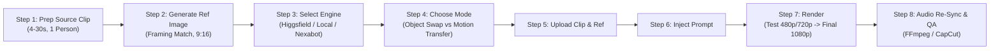

> [!IMPORTANT]
> **Mandatory Google Drive Sync Across All Video Skills**:
> Every video generated (AI video, character swap, commercial, explainer, reel, or tutorial clip) MUST be organized and uploaded to **Google Drive** immediately upon generation/assembly.
> 
> **Hierarchy Structure:**
> `AI VIDEO` -> `<MONTH YYYY>` -> `<PROJECT TITLE>` (e.g. `AI VIDEO` -> `NOV 2026` -> `<PROJECT TITLE>`)
> 
> **Required Folder Assets:**
> - Final rendered/assembled video(s) (master MP4, audio-synced versions, split-screen comparisons)
> - Source clips and character reference images (`character_ref.png`, `source_raw.mp4`, `prep_ready.mp4`)
> - Audio / VO files (`.wav`, `.mp3`)
> - Manifests, prompt logs, and generation scripts (`.py`, `.json`)
> 
> **CLI Upload Commands:**
> `gdrive mutate mkdir "<PROJECT TITLE>" --parent <MONTH_FOLDER_ID>`
> `gdrive mutate upload "<FILE>" --parent <PROJECT_FOLDER_ID>`

---

# GENJUTSU: Character Swap & Transformation Engine
### Your Clip, Your Moves, Your Voice, A Brand-New Character

**Genjutsu** transforms a real video of yourself or another person into any stylized character—such as 3D animation (Pixar/Dreamworks style), anime, claymation, pixel-art, or a talking creature—while keeping the real room, background, lighting, camera motion, facial expressions, and body timing 100% intact.

---

## 🛠️ The Production Toolset & Engines

1. **AI Character Swap Engine**:
   - **Nexabot Engine: Mode `r2v` (Reference-to-Video — Mandatory Global Default)**:
     Nexabot's native `r2v` mode takes your source video (`--media source.mp4`) and transforms it based on your character reference image (`--media character.png`) and prompt.
     - **Cost**: Only **0.15 credit** per generation (or **0 credit / Free** on API Unlimited plan).
     - **Output**: 1080p or 720p Full HD video matching the original motion and framing.
     - **Command**:
       ```powershell
       bun "${NEXABOT_TS:-$ROOT/vendor/Motion_as_kit/nexabot/nexabot.ts}" r2v "<prompt>" --media prep_ready.mp4 --media character_ref.png --ratio 2 --res 1080 --out swapped_r2v.mp4
       ```
   - **Higgsfield Genjutsu Web/Cloud**: `https://higgsfield.ai/genjutsu` (Object Swap & Motion Transfer).
   - **Genjutsu Open-Source Workflow**: `https://github.com/sirioberati/Genjustsu-Open-Source-Workflow` (local ComfyUI/Diffusers pipeline).

2. **Character Reference Generator**:
   - **Nexabot GPT Image 2.5 (Default)**: Cost **0.10 credit/image** (endpoint `POST /api/v1/gpt-image`).
     ```powershell
     bun "${NEXABOT_TS:-$ROOT/vendor/Motion_as_kit/nexabot/nexabot.ts}" gpt-image "<prompt>" --aspect 5 --out character_ref.png
     ```
   - **VOSU / GPT Image 2.0**: `https://vosu.ai/generate/image/gpt-image-2.0`.
   - **Nexabot Standard Image**: `bun nexabot.ts img "<prompt>" --aspect 5` (0.15 credit).

3. **Audio Re-Sync & Post-Production**:
   - Automated via bundled script: `python scripts/genjutsu_tool.py sync-audio -o source.mp4 -s swapped.mp4 -output final.mp4`
   - CapCut / FFmpeg CLI.

---

## 🎯 The 4 Golden Priority Rules

1. **Frame-by-Frame Motion Match**: Body movements, gestures, head turns, and mouth movement must track the actor frame-by-frame.
2. **Environment & Lighting Lock**: When using **Object Swap**, the background, furniture, practical lighting, and camera pans/zooms must remain identical to the original video.
3. **Framing Match Rule (Critical)**:
   - If the source video is **waist-up**, the character reference image MUST be **waist-up**.
   - If the source video is a **close-up**, the character reference MUST be a **close-up**.
   - *Never supply a full-body character reference for a waist-up video*—it shrinks facial resolution and causes blurring.
4. **Single Consistent Character Reference**: Use ONE clean, well-lit reference image. Mixing disparate images confuses the latent feature injection.

---

## 📋 The 8-Step End-to-End Workflow



### STEP 1: Get Your Clip Ready
- **Duration**: **4 to 30 seconds**. Genjutsu enforces a strict 4–30s window. If source footage is longer, trim it into 15s–30s segments.
- **Subject**: Exactly **one person** in frame for optimal tracking.
- **Framing**: Keep face clearly visible, avoid extreme dark shadows or excessive motion blur.
- **Format**: MP4 or MOV, under 200MB, preferably vertical 9:16 (1080×1920) for Reels/Shorts/TikTok.
- **Automated Prep Command**:
  ```powershell
  python scripts/genjutsu_tool.py prep -i "raw_footage.mp4" -o "prep_ready.mp4" -s 0 -e 15 --vertical
  ```

---

### STEP 2: Generate New Character Reference Image
Generate the character reference using Nexabot GPT Image 2.5 (0.10 credit) or VOSU GPT Image 2.0.

#### Character Framing Match:
- Waist-up footage ➔ Waist-up reference image.
- Close-up footage ➔ Head-and-shoulders portrait reference.
- Vertical 9:16 aspect ratio (`--aspect 5`).

#### Master Character Reference Prompts (Copy & Paste):

##### Style A: 3D Animated Character (Family-Film / Pixar Look)
```text
Character reference of a stylized 3D animated young man, waist-up, facing the camera, standing in front of a plain soft grey background with gentle even studio light. Big expressive eyes, warm brown skin, short curly black hair, a friendly confident half smile. He wears an oversized mustard-yellow hoodie with the sleeves pushed up. Clean animated family-film look, soft shadows, detailed skin and fabric texture, neutral relaxed pose with arms down. Vertical 9:16, no text, no logos.
```
*Nexabot CLI:*
```powershell
bun "${NEXABOT_TS:-$ROOT/vendor/Motion_as_kit/nexabot/nexabot.ts}" gpt-image "Character reference of a stylized 3D animated young man, waist-up, facing the camera, standing in front of a plain soft grey background with gentle even studio light. Big expressive eyes, warm brown skin, short curly black hair, a friendly confident half smile. He wears an oversized mustard-yellow hoodie with the sleeves pushed up. Clean animated family-film look, soft shadows, detailed skin and fabric texture, neutral relaxed pose with arms down. Vertical 9:16, no text, no logos." --aspect 5 --out character_3d.png
```

##### Style B: Anime Character (Cel-Shaded)
```text
Character reference of an anime-style young woman, waist-up, facing the camera, against a plain soft grey background with even, soft lighting. Long silver hair with a straight fringe, sharp violet eyes, a calm, slightly playful expression. She wears a black high-collar jacket with thin red trim. Clean cel shading, crisp line art, neutral relaxed pose with arms down. Vertical 9:16, no text, no logos.
```
*Nexabot CLI:*
```powershell
bun "${NEXABOT_TS:-$ROOT/vendor/Motion_as_kit/nexabot/nexabot.ts}" gpt-image "Character reference of an anime-style young woman, waist-up, facing the camera, against a plain soft grey background with even, soft lighting. Long silver hair with a straight fringe, sharp violet eyes, a calm, slightly playful expression. She wears a black high-collar jacket with thin red trim. Clean cel shading, crisp line art, neutral relaxed pose with arms down. Vertical 9:16, no text, no logos." --aspect 5 --out character_anime.png
```

##### Style C: Handcrafted Claymation
```text
Character reference of a handcrafted claymation stop-motion figure, waist-up, facing the camera, standing against a neutral tactile background. Visible fingerprint textures, soft plasticine material, warm studio lighting, miniature scale depth of field, charming quirky character design. Vertical 9:16, no text.
```

##### Style D: Retro 16-Bit Pixel Art Hero
```text
Character reference of a modern high-detail 16-bit pixel art hero character, waist-up portrait, clean dithering, vibrant retro color palette, crisp outlines, facing camera, neutral pose. Vertical 9:16, no text.
```

##### Style E: Anthropomorphic Animal Character
```text
Character reference of an anthropomorphic friendly red fox character, waist-up, wearing a modern stylish denim jacket, photorealistic fur texture, expressive amber eyes, standing in front of a soft neutral studio background. Vertical 9:16, no text.
```

---

### STEP 3: Setup Engine & Open Genjutsu

#### Option A: Nexabot Native `r2v` (Mandatory Automated Route)
Nexabot executes character swap directly via `r2v` (0.15 credit or free on API Unlimited):
```powershell
# Run via bun directly
bun "${NEXABOT_TS:-$ROOT/vendor/Motion_as_kit/nexabot/nexabot.ts}" r2v "Replace the person in the video with the character from the reference images. Keep the background, lighting, camera movement and framing exactly as in the original. Match the original body movement, head turns, facial expressions, lip movement and timing frame by frame. Keep the character's face, hair, outfit and colors the same in every frame." --media prep_ready.mp4 --media character_ref.png --ratio 2 --res 1080 --out swapped_r2v.mp4

# Or via batch clips.json
bun "${NEXABOT_TS:-$ROOT/vendor/Motion_as_kit/nexabot/nexabot.ts}" batch clips.json --parallel 2
```

#### Option B: Higgsfield Web UI
- Go to `https://higgsfield.ai`, sign in, open **Video** ➔ **Create Video** ➔ select **Genjutsu** in the model picker.

#### Option C: Local Open-Source ComfyUI
- Load `Genjutsu-Open-Source-Workflow` from GitHub (`https://github.com/sirioberati/Genjustsu-Open-Source-Workflow`) on your local workstation with your own custom checkpoints/LoRAs.

---

### STEP 4: Choose Transformation Mode

| Mode | What it Does | Best Used For |
| :--- | :--- | :--- |
| **Object Swap** *(Default)* | Replaces **only the person**. Room, lighting, background objects, camera moves stay **100% identical**. | Reality-bending reels, creator talking heads, avatar swaps in real rooms. |
| **Motion Transfer** | Transfers actor's movements & expressions, but **redraws the entire scene/background** into the chosen art style. | Stylized fantasy worlds, anime conversions, total artistic immersion. |
| **Outfit Only** | Retains real human face and features, swapping only the clothes/wardrobe. | Fashion try-on, superhero suit reveals, digital cosplay. |

---

### STEP 5: Upload Video Clip & Character Reference
1. Drop `prep_ready.mp4` into the **Source video** slot.
2. Click **+** under **Reference images** and upload `character_ref.png`.
3. Do not upload multiple conflicting character angles in one batch; stick to one high-resolution anchor image.

---

### STEP 6: Add The Production Prompt
Turn on the **Prompt** switch and paste the exact master prompt:

```text
Replace the person in the video with the character from the reference images. Keep the background, lighting, camera movement and framing exactly as in the original. Match the original body movement, head turns, facial expressions, lip movement and timing frame by frame. Keep the character's face, hair, outfit and colors the same in every frame.
```

> [!TIP]
> **Negative / Avoid Rules**: Avoid morphing limbs, flickering textures, sudden color shifts, warped backgrounds, multiple heads, or changing outfit across cuts.

---

### STEP 7: Quality & Generation Strategy
1. **Pilot Test**: Run first test at **480p** or **720p** (Genjutsu Lite / Fast mode) to verify tracking accuracy and hand-face interactions.
2. **Review Pilot**:
   - Check rapid hand gestures crossing the face.
   - Check sharp head turns.
3. **Master Render**: Once satisfied, render full resolution at **1080p**.

---

### STEP 8: Check & Add Your Voice Back (Audio Re-Sync)
AI video generation platforms frequently strip audio or return silent video streams. Use the bundled automation tool to remux the original clean audio with zero video quality loss:

```powershell
python scripts/genjutsu_tool.py sync-audio -o "prep_ready.mp4" -s "genjutsu_swapped_1080p.mp4" --output "master_finished.mp4"
```

*Or via raw FFmpeg:*
```bash
ffmpeg -y -i genjutsu_swapped_1080p.mp4 -i prep_ready.mp4 -c:v copy -c:a aac -b:a 192k -map 0:v:0 -map 1:a:0? -shortest master_finished.mp4
```

---

## 🎬 Viral UGC / Tutorial Reel Production Package

Want to publish a viral tutorial video teaching this workflow? Here is the complete production script and shotlist:

```
FORMAT: 9:16 Vertical Video (TikTok / Reels / YouTube Shorts)
TARGET DURATION: 25 - 30 seconds
STYLE: High-energy creator tutorial / split-screen showcase
VOICE: Fast, confident, engaging (Nexabot TTS 'Puck' or Gemini TTS 'Puck')
```

### Shot-by-Shot Timeline Breakdown

| Beat | Script (Spoken Voiceover) | Visual On-Screen Action | Production Asset / Code |
| :---: | :--- | :--- | :--- |
| **0:00 - 0:04**<br/>(Line 1: Hook) | *"Higgsfield's Genjutsu lets you swap yourself for any character in your own clip, and it takes about a minute."* | **Split-Screen Dynamic Reveal**: Real video on left, finished 3D/anime character on right, moving in 100% synchronized lockstep. | `python scripts/genjutsu_tool.py split-screen -l prep_ready.mp4 -r master_finished.mp4` |
| **0:04 - 0:09**<br/>(Line 2: Inputs) | *"All you have to do is open Genjutsu, drop in your clip, and add a reference image of the new character."* | **Screen Recording**: Cursor dragging video clip into Source Video slot, then uploading character reference image. | High-res UI screencast with subtle cursor zoom. |
| **0:09 - 0:14**<br/>(Line 3: Mode) | *"Pick Object Swap, so your scene stays exactly the same and only you get replaced."* | **Close-up on UI**: Clicking 'Object Swap' button. Rapid 0.5s toggle showing background staying frozen while subject changes. | Punch-in zoom on button + background freeze overlay. |
| **0:14 - 0:19**<br/>(Line 4: Magic) | *"It follows your movements, your expressions and your timing, so the new character moves exactly like you do."* | **Isolated Side-by-Side Movement**: Focus on a head turn, a smile, and a hand gesture matching perfectly. | Dual cropped 540x1920 comparison strip. |
| **0:19 - 0:24**<br/>(Line 5: Sound) | *"Then hit Generate, and if it comes back silent, just drop your original audio back in."* | **Fast Action**: Clicking Generate, quick cut to result, then 1-second view of CapCut / FFmpeg snapping original audio track below video. | Timeline audio snap animation. |
| **0:24 - 0:28**<br/>(Line 6: CTA) | *"Comment 'Free' and I'll send you the full step-by-step guide."* | **Freeze Frame**: Stylized character smiles directly into camera with bold on-screen callout: **COMMENT "FREE"**. | High-contrast kinetic typography. |

---

## 🔍 Quality Assurance & Troubleshooting Guide

| Issue Encountered | Root Cause | Solution |
| :--- | :--- | :--- |
| **Face looks blurry or low-res** | Reference image was full-body while video was waist-up. | **Enforce Framing Match**: Regenerate reference image with `waist-up` or `close-up portrait` prompt matching camera distance. |
| **Room / background changes** | Switched to Motion Transfer instead of Object Swap. | Ensure **Object Swap** is active. Add prompt: *"Keep the background, walls, furniture, lighting, and camera movement identical to original."* |
| **Flickering hands or extra fingers** | Actor moved hands too fast across the face. | Pre-trim footage with `genjutsu_tool.py prep` to eliminate erratic hand movements, or re-record with deliberate, smooth gestures. |
| **Video output is silent** | Generator doesn't support direct audio pass-through. | Run `python scripts/genjutsu_tool.py sync-audio -o prep_ready.mp4 -s output.mp4`. |
| **Video exceeds 30 seconds** | Higgsfield hard constraint violation. | Cut source clip into 15–20 second chapters, generate each separately, then concatenate. |

---

## 💻 CLI Commands Quick Reference

```powershell
# 1. Inspect & prepare raw video (trim to 15s, ensure 9:16 vertical)
python scripts/genjutsu_tool.py prep -i "input.mp4" -o "prep_ready.mp4" -s 0 -e 15 --vertical

# 2. Get character prompts & Nexabot generation command
python scripts/genjutsu_tool.py prompt --style 3d
python scripts/genjutsu_tool.py prompt --style anime

# 3. Generate reference character image (0.10 credit via Nexabot)
bun "${NEXABOT_TS:-$ROOT/vendor/Motion_as_kit/nexabot/nexabot.ts}" gpt-image "<character_prompt>" --aspect 5 --out character_ref.png

# 4. Swap character via Nexabot r2v mode (0.15 credit or Free on API Unlimited)
python scripts/genjutsu_tool.py r2v -v "prep_ready.mp4" -c "character_ref.png" --ratio 2 --res 1080 -o "swapped_r2v.mp4"

# Direct Nexabot CLI execution:
bun "${NEXABOT_TS:-$ROOT/vendor/Motion_as_kit/nexabot/nexabot.ts}" r2v "Replace the person in the video with the character from the reference images. Keep the background, lighting, camera movement and framing exactly as in the original. Match the original body movement, head turns, facial expressions, lip movement and timing frame by frame. Keep the character's face, hair, outfit and colors the same in every frame." --media prep_ready.mp4 --media character_ref.png --ratio 2 --res 1080 --out swapped_r2v.mp4

# 5. Remove Gemini watermark
ffmpeg -i "swapped_r2v.mp4" -vf "delogo=x=855:y=1695:w=95:h=95" clean_swapped.mp4

# 6. Sync original audio back to silent swapped video
python scripts/genjutsu_tool.py sync-audio -o "prep_ready.mp4" -s "clean_swapped.mp4" --output "final_video.mp4"

# 7. Generate split-screen comparison reel (Real vs Character)
python scripts/genjutsu_tool.py split-screen -l "prep_ready.mp4" -r "final_video.mp4" --output "comparison_reel.mp4"
```
