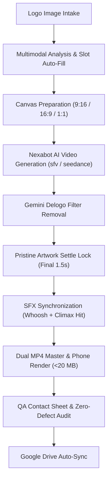

> [!IMPORTANT]
> **Mandatory Daily Nexabot API Check:** Before generating any assets with Nexabot, run:
> `bun "${NEXABOT_TS:-$ROOT/vendor/Motion_as_kit/nexabot/nexabot.ts}" check`
> This verifies active endpoints, models, and pricing against https://nexabot.id/developers and /api/v1/modes.


# Logo Reveal (Cinematic AI Logo Video Generator)

Turn any attached logo image into a high-end, commercial-grade **Logo Reveal Video** using automated multimodal deconstruction, Nexabot video generation, synchronized sound design, and pristine brand-lock settle.

```bash
NB="${NEXABOT_TS:-$ROOT/vendor/Motion_as_kit/nexabot/nexabot.ts}"
S="$ROOT/.claude/skills/logo-reveal/scripts"
```

---

## 1. The Core Prompt Template

When a logo image is provided or attached, deconstruct its visual elements and auto-fill the exact template prompt:

```text
"A [overall style/vibe] logo design on a [background color] background. It features a [shape/style] [color] outer [main visual element] and a [color] inner [main visual element]. At the top is a [small secondary element, e.g., small icon or symbol]. Below the main elements is [description of middle element/calligraphy]. At the bottom, the text '[Text Line 1]', '[Text Line 2]', and '[Text Line 3]' is stacked in a [font description, e.g., clean, gray sans-serif] font."
```

### Slot-Filling Taxonomy & Examples

| Slot | Description | Examples |
|---|---|---|
| `[overall style/vibe]` | Aesthetic essence | `minimalist corporate`, `elegant floral`, `modern tech`, `luxury gold metallic`, `heritage heraldic crest`, `sleek cyber aesthetic`, `organic artisanal` |
| `[background color]` | Environment backdrop | `clean studio white`, `dark obsidian matte`, `deep midnight navy`, `warm cream linen`, `textured dark charcoal` |
| `[shape/style]` | Outer silhouette | `circular geometric`, `ornate baroque shield`, `hexagonal faceted`, `flowing ribbon`, `arched classical`, `symmetrical emblem` |
| `[color] outer [main visual element]` | Primary outer frame | `burnished gold outer archway`, `matte black outer shield`, `cobalt blue outer ring`, `silver metallic outer polygon` |
| `[color] inner [main visual element]` | Core symbol inside | `emerald green inner leaf`, `warm amber inner flame`, `platinum white inner starburst`, `golden inner crest` |
| `[small secondary element]` | Accent icon at top | `a miniature five-pointed golden star`, `a delicate crown symbol`, `a geometric diamond icon`, `a subtle compass rosette` |
| `[description of middle element/calligraphy]` | Core emblem / lettering | `an intricate Arabic thuluth calligraphy ligature`, `an interlocking monogram lettermark`, `a dynamic sweeping velocity arc` |
| `'[Text Line 1]'`, `'[Text Line 2]'`, `'[Text Line 3]'` | Exact typography lines | `'THE HERITAGE CLUB'`, `'FINE DINING & LOUNGE'`, `'EST. 1984'` (adapt to actual lines present) |
| `[font description]` | Typographic styling | `bold black serif`, `elegant gold script`, `modern blue sans-serif`, `clean, gray sans-serif`, `crisp white tracked-out sans-serif` |

> [!TIP]
> **Adapting to Minimalist Logos:**
> If the logo does not have all elements (e.g. only 1 line of text or no top icon), adapt gracefully:
> - If no top icon: *"At the top is clean negative space."* or omit the sentence.
> - If 1 or 2 lines of text: *"At the bottom, the text '[Brand Name]' is set in a [font description] font."*
> - If transparent background: Default to a complementary dark obsidian (`#0D0D11`) or clean studio backdrop matching the brand identity.

---

## 2. Six Signature Reveal Motion Recipes

### 1. `golden-ribbon-trace` ⭐ (Primary Signature · Reference Benchmark)
> *"Cinematic logo reveal animation. On a clean off-white studio background with soft central lighting, fine luminous contours and glowing golden line-art trace out the logo elements from the top down. The outer and inner shapes emerge with elegant dimensional extrusion. A dynamic swirling ribbon of golden stardust and sparkling light particles sweeps gracefully across the calligraphy and typography from left to right, illuminating each line into crisp, vibrant solid color. The camera smoothly pulls back into a centered wide shot as delicate lens flare glints travel across the beveled edges, settling into a razor-sharp, stable, pristine logo lockup with soft contact drop shadow. 8K commercial studio lighting, ultra-sharp vector details, zero warping, pristine commercial finish."*

### 2. `light-sweep` (Epic & Luxury)
> *"Cinematic light sweep animation. On a clean studio background, radiant volumetric light rays and floating micro-particles trace the outer and inner contours. Specular rim reflections glide smoothly across the typography from bottom to top, settling cleanly into the crisp, illuminated emblem with subtle lens shimmer."*

### 3. `3d-bevel` (Corporate · Tech · Industrial)
> *"Premium 3D metallic extrusion reveal. The beveled emblem emerges with rich depth, slowly rotating in soft studio cyclorama lighting. Gentle amber and platinum rim reflections highlight the beveled edges, smooth camera ease-out settling into a razor-sharp frontal lockup."*

### 4. `liquid-gold` (Jewelry · Automotive · High-End)
> *"Luxurious molten liquid gold materialization. Molten chrome and liquid amber caustics pool and flow across a dark glossy surface, swirling upward and instantly hardening into the sculpted metallic logo contours with micro-refractions and crystal clarity."*

### 5. `cyber-neon` (Gaming · Crypto · SaaS)
> *"High-energy cyberpunk circuit surge. Electric cyan and magenta energy pulses ignite along the vector paths. Dynamic sparks trace the calligraphy and secondary symbols, culminating in a bright shockwave that resolves into the stable, glowing solid neon emblem."*

### 6. `smoke-ink` (Artisanal · Heritage · Storytelling)
> *"Dramatic organic ink and volumetric smoke dispersion. Swirling tendrils of colored smoke bloom outward from the center in slow motion, gently revealing the outer shapes and typography before condensing into a clean, solid, opaque vector emblem on a textured backdrop."*

---

## 3. End-to-End Execution Workflow



### Step 1: Analyze Logo & Auto-Fill Template
Run the automated image analyzer to inspect geometry, transparency, and palette:
```bash
python $S/analyze_logo.py <path_to_logo.png> --ratio 9:16
```
Antigravity inspects the image visually, verifies the detected slots, and displays the filled prompt to the user.

### Step 2: User Style Selection & Pre-Approval
Present the filled template prompt and ask the user to confirm or choose the reveal style:
- Options: `light-sweep` (recommended), `3d-bevel`, `liquid-gold`, `cyber-neon`, `smoke-ink`.
- Aspect ratio: `9:16` (Vertical / Reels), `16:9` (Horizontal / YouTube), `1:1` (Square).

### Step 3: Run Full Production Engine
Execute `build_reveal.py` to handle generation, watermark removal, settle lock, audio, and export:
```bash
python $S/build_reveal.py <logo.png> \
  --prompt "<auto_filled_prompt>" \
  --style light-sweep \
  --ratio 9:16 \
  --mode sfv \
  --title "Logo Reveal - BrandName"
```

---

## 4. Quality Rules & Zero-Defect Gates

### A. Pristine Artwork Settle Lock (100% Brand Accuracy)
AI video generation can drift or distort small typography after several seconds. To guarantee zero defects:
- The script automatically crossfades the original, razor-sharp logo artwork onto the final 1.5 seconds of the video.
- The video ends on the authentic, pixel-perfect brand mark with pristine readability.

### B. Gemini Watermark Removal
Every Nexabot clip undergoes exact resolution-matched delogo:
- Vertical `1080x1920`: `delogo=x=855:y=1695:w=95:h=95`
- Vertical `720x1280`: `delogo=x=565:y=1125:w=68:h=68`
- Landscape `1920x1080`: `delogo=x=1695:y=855:w=95:h=95`
- Landscape `1280x720`: `delogo=x=1130:y=570:w=63:h=63`
- Square `1080x1080`: `delogo=x=855:y=855:w=95:h=95`

### C. Sound Design Pipeline
Audio is pulled from `${SFX_DIR:-$ROOT/assets/sfx}`:
- **Intro Buildup (0.0s - 2.5s):** Volumetric atmospheric whoosh (`whoosh/swosh_swoosh_whoosh_air_sound_free_high__f1dc6045.mp3`) or riser.
- **Climax Payoff (2.5s):** Heavy cinematic hit (`hit/hit_impact_7f3dc6f7.mp3`) or crystal chime (`chime/chime_notification_adb6e260.mp3`).
- **Tail (2.5s - End):** Smooth harmonic decay.

### D. Dual Deliverables & Google Drive Sync
- **Master MP4:** Full resolution, `-crf 17`, uncompressed clarity.
- **Phone MP4:** Strictly under 20 MB, `-crf 23`, `-movflags +faststart`.
- **QA Contact Sheet:** 1 fps strip verifying zero defects.
- **Auto-Sync:** Synced immediately to `AI VIDEO -> <MONTH YYYY> -> <PROJECT TITLE>` via `${MOTION_KIT:-$ROOT/vendor/Motion_as_kit}/sync_gdrive.py`.
