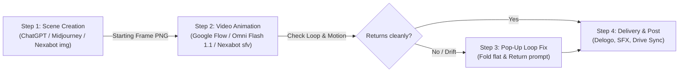

> [!IMPORTANT]
> **Mandatory Daily Nexabot API Check:** Before generating any assets with Nexabot, run:
> `bun "${NEXABOT_TS:-$ROOT/vendor/Motion_as_kit/nexabot/nexabot.ts}" check`
> This verifies active endpoints, models, and pricing against https://nexabot.id/developers and /api/v1/modes.


# Origami Motion Graphics (Full Production Guide)

Turn any landmark, city, architectural icon, natural landscape, or product into a cinematic 3D layered papercraft animation and pop-up book motion graphic.

Based on the core 2-tool AI workflow by `@manish.build.ai` and enhanced for automated, defect-free production pipelines.

```bash
NB="${NEXABOT_TS:-$ROOT/vendor/Motion_as_kit/nexabot/nexabot.ts}"
SCRIPT="$ROOT/.claude/skills/origami-motion-graphics/scripts/build_origami.py"
```

---

## 1. The Core 2-Tool Workflow Overview



| Phase | Manual AI Tool (Web UI) | Automated Production Tool (Nexabot CLI) |
|---|---|---|
| **Scene Generation** | ChatGPT (DALL-E) / Midjourney | `nexabot.ts img "<prompt>" --aspect 2|5` |
| **Motion Animation** | Google Flow (Omni 1.1 Flash) | `nexabot.ts sfv "<prompt>" --media <frame> --ratio 1|2` |
| **Watermark Removal** | Manual crop / After Effects | Automated FFmpeg `delogo` |
| **Sound Design** | Manual DAW placement | `openverse-sfx` + `real-sfx` (paper creases & snaps) |

---

## 2. Step 1 — Create the Scene (Starting Frame)

### The Master Diorama Prompt Formula
```text
Layered papercraft diorama of [City/Landmark/Subject]: [Foreground elements with clear silhouette], [Midground main architecture/subject with dimensional layers], [Background secondary structures or hills], textured handmade paper, cut-paper layers with physical depth, folded paper [vegetation/trees], a big paper [sun/moon], puffy folded paper clouds, [warm sunrise/sunset/mood palette] colours. [Landscape 16:9 or Vertical 9:16], no text, no people.
```

### Reference Benchmark: Delhi India Gate (from Guide)
```text
Layered papercraft diorama of Delhi: India Gate in front, Qutub Minar and the Lotus Temple behind, textured handmade paper, cut-paper layers with depth, folded paper trees, a big paper sun, puffy folded paper clouds, warm sunrise colours. Landscape 16:9, no text, no people.
```

### Style Consistency Lock (For Series / Explainers)
When generating multiple scenes for a consistent travel series or explainer, append:
```text
in the exact same style as my previous image: textured handmade paper, visible fibrous grain, cut-paper layers with physical depth, warm sunrise colours.
```

---

## 3. Step 2 — Animate the Image into Motion

### Google Flow Settings (Manual Mode)
1. Navigate to **Google Flow** (`labs.google/flow/`) with Google AI Pro or Ultra.
2. Go to **Settings → Video generation**.
3. Model: **Gemini Omni 1.1 Flash**.
4. Aspect ratio: **16:9** (YouTube / Landscape) or **9:16** (Reels / TikTok).
5. Upload generated scene as the **starting frame**.
6. Generate 2 takes and select the one with the cleanest creases and zero morphing.

### Master Motion Prompt
```text
Animate this scene in origami form video. The papercraft landmarks, trees, clouds and hills move and fold dynamically with intricate paper folding and unfolding origami animations. Slow cinematic camera movement across the scene with soft shifting light and cast shadows along paper creases.
```

---

## 4. Step 3 — Fix Scenes That Don't Return to Original (The Pop-Up Loop Fix)

Sometimes a landmark folds away but drifts or fails to reassemble into the original composition. When creating **seamless loops**, **social media hooks**, or **clean transitions**, use this revised prompt:

### The Pop-Up Return Prompt
```text
Animate this scene in origami form video. Everything folds flat with intricate origami folding, then unfolds and pops back up like a pop-up book, returning EXACTLY to the original scene. End on the complete original scene.
```

**Key Benefit:** The scene starts on the composition, compresses flat into crisp paper creases, then springs back upright into the pixel-perfect original state.

---

## 5. Automated Production Pipeline (Nexabot Engine)

Under the global environment rules, all AI image and video generation should be executed through Nexabot rather than waiting for manual uploads.

### Step 1: Pre-Approval Frame Generation
Generate the still image and present the visual to the user:
```bash
# Landscape 16:9 (aspect code 2)
bun "$NB" img "<image_prompt>" --aspect 2 --out "images/origami_scene.png"

# Vertical 9:16 (aspect code 5)
bun "$NB" img "<image_prompt>" --aspect 5 --out "images/origami_scene.png"
```
> [!IMPORTANT]
> **Mandatory Pre-Approval Gate:** Display the start-frame image to the user in chat or an artifact. Do NOT generate video clips until the user approves the keyframe.

### Step 2: Animate via Nexabot sfv
```bash
# 16:9 Landscape (ratio 1, 1080p)
bun "$NB" sfv "<motion_prompt>" --media "images/origami_scene.png" --ratio 1 --res 1080 --out "clips/raw_clip.mp4"

# 9:16 Vertical (ratio 2, 1080p)
bun "$NB" sfv "<motion_prompt>" --media "images/origami_scene.png" --ratio 2 --res 1080 --out "clips/raw_clip.mp4"
```

### Step 3: All-in-One CLI Tool
Use the bundled Python builder to run the complete pipeline with watermark removal and QA contact sheet:
```bash
python "$SCRIPT" \
  --title "Delhi India Gate" \
  --ratio 16:9 \
  --image-prompt "Layered papercraft diorama of Delhi: India Gate in front, Qutub Minar..." \
  --project-dir "projects/delhi_origami"
```

---

## 6. Sound Design & Tactile Audio Pipeline

Paper animations feel flat without tactile audio. Follow the mandatory SFX pipeline:

1. **Openverse CC0 Paper Sounds:**
   - Search for tactile paper elements: `paper rustle`, `crease snap`, `cardstock fold`, `pop-up book swish`, `paper flutter`.
   - Local library path: `${SFX_DIR:-$ROOT/assets/sfx}/paper/`.
2. **Placement with `real-sfx`:**
   - Frame-lock each sound effect to the exact frame where a fold hinges or locks into place.
   - Mix background ambient room tone or subtle orchestral swell under the paper Foley.

---

## 7. Quality Inspection & Zero-Defect Gates

Before finalizing or delivering:

1. **1 fps Contact Sheet Inspection:**
   - Extract a 1 fps contact strip using `ffmpeg` or `build_origami.py`.
   - Inspect every frame: verify paper planes stay rigid and tactile, with no digital gelatin morphing or stray text hallucinated on the paper.
2. **Watermark Removal (Delogo):**
   - **Vertical 9:16 (1080x1920):** `delogo=x=855:y=1695:w=95:h=95`
   - **Landscape 16:9 (1920x1080):** `delogo=x=1710:y=970:w=140:h=60`
   - **Landscape 16:9 (1280x720):** `delogo=x=1130:y=570:w=63:h=63`
3. **Google Drive Sync:**
   - Upload completed master video, start-frame image, clean contact sheet, and prompt manifest to:
     `AI VIDEO -> <MONTH YYYY> -> <PROJECT TITLE>`

---

## 8. Best Use Cases

* **History & Travel Channel Intros:** Introduce a city, country, or landmark with a distinctive, tactile papercraft aesthetic.
* **Explainer Video Scene Transitions:** Fold flat out of one topic or location, and pop up into the next chapter.
* **Shorts & TikTok Scroll-Stopping Hooks:** The initial pop-up book unfold motion commands immediate visual retention in the first 2 seconds.
* **Architecture & Real Estate Vignettes:** Showcase buildings as miniature collectible paper art.
* **Luxury Packaging & Unboxing:** Unfold geometric origami packaging to reveal a hero product.
